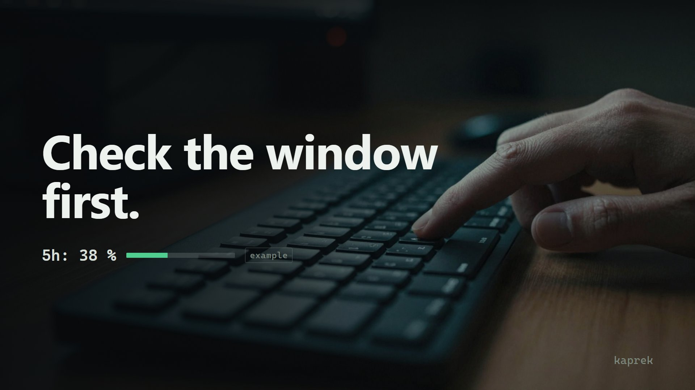

<!--
slug: check-plan-window-before-session
meta-description: Read the 5-hour and 7-day plan windows before a Claude Code session starts, with kaprek proxy and kaprek proxy status. Unofficial tool.
-->

# Check your Claude plan window before the session starts



It is 23:40 and a long run is about to start. Maybe it is a refactor across forty files, or a scheduled job that will run until morning. The question before you press Enter is plain: how much of the 5-hour window is already gone, and when does it reset? If the window is at 90 %, the run stalls after an hour. If it resets at 01:00, it might be better to wait.

`kaprek proxy` and `kaprek proxy status` answer it from a terminal, before any session exists. kaprek is an unofficial, open-source tool. It has no connection to Anthropic.

## What Claude Code already shows

Inside a running session, Claude Code tells you where you stand. On a subscription, `/usage` shows plan usage bars. The status line gets a `rate_limits` field with the 5-hour and 7-day windows. According to the status line docs, that field appears after the session's first API response, and a window drops out once its reset time has passed. For a session that is already working, these two are the place to look.

What they do not cover: the moment before the first response, a second terminal that has no session, and a sum per project over the week. kaprek covers those three.

## Keep the last reading on disk: `kaprek proxy`

Responses from `api.anthropic.com` carry the plan windows in headers (`anthropic-ratelimit-unified-*`). `kaprek proxy` is a local pass-through that sits between Claude Code and that address. It reads those headers along the way and writes the last reading to disk. The next time you look, the number is there, even with no session open.

### Start it and point one terminal at it

In one terminal:

```
kaprek proxy
```

It listens on `127.0.0.1:4911` until you press Ctrl+C. `--port N` or the variable `KAPREK_PROXY_PORT` pick another port. It only binds to loopback.

In the terminal you start `claude` from, set one variable. In cmd:

```
set ANTHROPIC_BASE_URL=http://127.0.0.1:4911
```

In PowerShell:

```powershell
$env:ANTHROPIC_BASE_URL = "http://127.0.0.1:4911"
```

Only the base URL changes. Your saved claude.ai login stays the credential, because the proxy passes every header through untouched. According to Anthropic's [gateway documentation](https://code.claude.com/docs/en/llm-gateway), section "Subscriptions and gateways", your plan's limits then apply as before.

If you want this for every terminal, run `kaprek proxy autostart install` first. It puts a `kaprek-proxy.cmd` into your Windows startup folder, so the proxy starts at login. Only then is it safe to set `ANTHROPIC_BASE_URL` globally, for example under `env` in `~/.claude/settings.json`. The reason is in the Limits section below.

### What it records, and what it never stores

The proxy talks to `api.anthropic.com` and nowhere else. A test in the repo fails if that changes.

For each `/v1/messages` request it writes one log line: time, duration, session id, status, model, token counts, stop reason, the plan windows and the account. Other endpoints are relayed without a log line. Message bodies are streamed through and scanned only for the usage fields. Neither the body nor your token ends up on disk. The log rotates at 20 MB. Data goes into `<dataDir>/proxy/<hostname>/`, one folder per machine. If you sync kaprek's data directory between computers, each one still writes to its own folder, and kaprek reads the newest windows per account across all of them.

## Read it from a second terminal: `kaprek proxy status`

Back to 23:40. Open a second terminal, with no session in it, and run:

```
kaprek proxy status
```

Example output (made-up values, fictional date):

```
kaprek proxy runs (pid 4242, http://127.0.0.1:4911)
  5h: 38 % (reset 2026-01-01T14:00:00.000Z), seen 2026-01-01T11:12:03.000Z
  7d: 61 % (reset 2026-01-05T09:00:00.000Z), seen 2026-01-01T11:12:03.000Z
```

The first line says whether the proxy is up, with its pid and port. Each further line is one window: percent used, when it resets, and when the proxy saw that value. No request is sent to read this. You spend nothing to look.

### Reading "seen" and "reset"

All times end in `Z`. That is UTC. `14:00:00.000Z` is 15:00 in Berlin in winter and 16:00 in summer. If you plan around the reset, convert first.

A reset in the past is harder to spot. The proxy keeps the last reading it saw. If that reading is from yesterday, the 5h line still shows yesterday's percentage, next to a reset time that has already gone by. `kaprek proxy status` does not filter it out. Read it this way: a reset time in the past means the window has started over since then, and the percentage is old.

The "seen" time tells you how fresh the whole reading is. Four minutes old is close enough to plan with. Last Tuesday says little about tonight.

### Exit code 3 for scripts

`kaprek proxy status` exits with 0 when the proxy runs and with 3 when it does not. A pid file left behind by a crashed proxy counts as not running. The stored windows are printed in both cases, if there are any.

A scheduled job can check this before it starts Claude Code. If the exit code is 3 and the job relies on `ANTHROPIC_BASE_URL`, it can stop early with a clear message, instead of failing later when Claude Code has nothing to connect to.

## Tokens per project over seven days

The same data feeds a second view. With kaprek running, the page `#/quota` and the endpoint `GET /api/quota` sum the proxy's log over the last 7 days per project: requests, sessions, input, output and cache tokens.

A project is the folder name kaprek's session ledger recorded for that session id. Sessions without a ledger entry land in one bucket labelled `unbekannt` ("unknown"). The sums are tokens. The proxy stores no prices, so there is no cost figure here.

Without any proxy data, the Claude card on that page falls back to the last rate-limit event of a turn kaprek itself ran. Your own terminal sessions do not show up in that fallback.

**Example (invented):** a person runs two projects on one plan, a static site and a data-cleaning script. After a week behind the proxy, `#/quota` shows the script with most of the output tokens. They move its nightly run to the morning, after the 5-hour window has reset, and keep the evenings for the site.

## Limits

### Only requests through the proxy count

The proxy sees what passes through it. A session started in a terminal without `ANTHROPIC_BASE_URL` is invisible to it. So is usage from another computer or another client on the same plan. The windows only update when a proxied response comes back, and the token sums per project only count proxied requests.

### Variable set, proxy down: Claude Code cannot reach Anthropic

If `ANTHROPIC_BASE_URL` points at `127.0.0.1:4911` and nothing listens there, Claude Code has no route to Anthropic. Start the proxy again or remove the variable. This is why a global setting belongs together with `kaprek proxy autostart install`. When the proxy runs but `api.anthropic.com` is unreachable, it answers with a 502 and the header `x-should-retry: true`.

### One reading at a time

`kaprek proxy status` prints the newest reading of one account. The proxy does not pool accounts, does not switch between them, does not route Claude Code to other models. If you hold more than one Claude subscription, `kaprek accounts` is the separate place for that.

## Undo

Remove `ANTHROPIC_BASE_URL` from the terminal or from `settings.json`. If you installed the autostart entry, run:

```
kaprek proxy autostart uninstall
```

Claude Code then talks to Anthropic directly again.

kaprek is free and open source under Apache-2.0, and runs with `npx kaprek` on Node 22 or newer. The README section ["Plan windows and usage"](../README.md#plan-windows-and-usage-kaprek-proxy-quota) has the same commands in short form.

## FAQ

**Does `kaprek proxy status` show my live remaining quota?**
No. It prints the windows from the last response that went through the proxy, together with the time it saw them.

**What happens if the proxy stops while `ANTHROPIC_BASE_URL` still points at it?**
Claude Code cannot reach Anthropic until you start the proxy again or remove the variable.

**Does the proxy keep my prompts or my login?**
No. It relays both and records only timing, session id, model, token counts and the plan-window headers.
